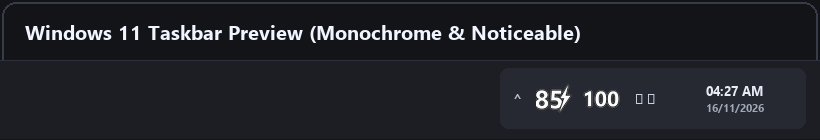
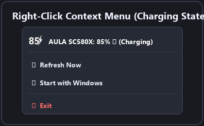
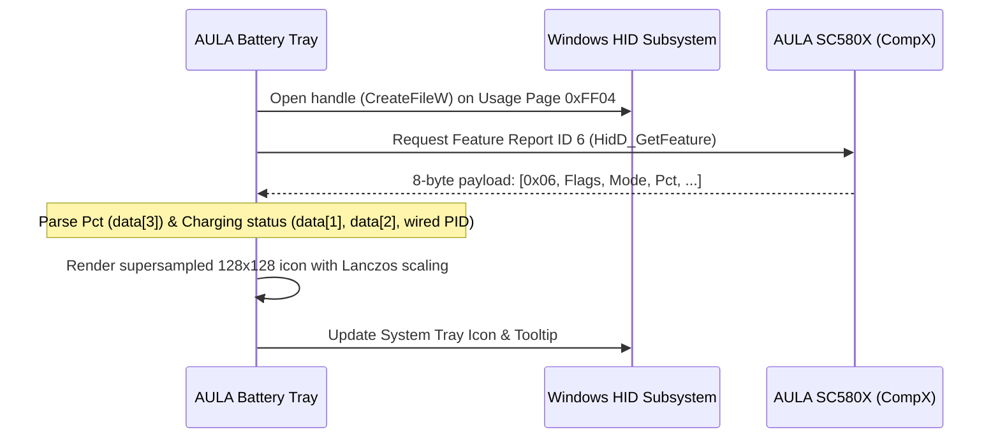

# AULA SC580X Battery Monitor 🪟⚡

A lightweight, high-visibility Windows System Tray battery indicator and charging monitor designed specifically for the **AULA SC580X Wireless Gaming Mouse**. Features a clean, monochromatic Windows-native aesthetic with instant glanceability, automated Type-C charging detection, and low-battery alerts.


---

## 🎯 The Problem It Solves

1. **No Battery Percentage over 2.4GHz Wireless in Windows:**
   Windows natively displays battery levels for standard Bluetooth accessories in *Settings > Bluetooth & Devices*, but **2.4GHz USB wireless dongles do not report battery percentages** through standard Windows battery APIs. Users are normally left guessing how much charge is remaining.

2. **Bloated & Resource-Heavy OEM Software:**
   Official manufacturer suites for budget gaming mice often consume 150–300 MB of RAM, run multiple background updater processes, collect unnecessary telemetry, and require opening an intrusive desktop window just to view battery health.

3. **Sudden Mid-Game Battery Cutoff:**
   Without a persistent, glanceable indicator, the mouse shuts down without warning in the middle of gaming sessions or productivity tasks.

4. **Blurry or Illegible System Tray Icons:**
   Many third-party tray widgets display tiny, colored, or low-resolution icons that look pixelated or blend invisibly into modern Windows 11 dark/light taskbars.

---

## 🖼️ Visual Showcase

### Dynamic Tray Icon States
The tray icon adapts dynamically to your mouse status with clean, high-contrast Segoe UI typography:


| State | Preview Indicator | Description |
| :--- | :---: | :--- |
| **Fully Charged** | `100` | Complete 100% battery capacity |
| **Normal Use** | `85` (Large Number) | Crisp, noticeable monochromatic digits filling the tray tile |
| **Type-C Charging** | `85⚡` | Automatically detects Type-C wired charging connection |
| **Low Battery Alert** | `15` | Battery $\le 20\%$; triggers desktop toast alert |
| **Disconnected / Sleep** | `?` | Dongle unplugged or mouse is in sleep mode |

---

### Windows 11 Taskbar Integration
Fits seamlessly alongside native Windows system icons (WiFi, Audio, Clock):



---

### Right-Click Context Menu
Quick actions available directly from the system tray:



---

## ✨ Key Features

- **Monochromatic Windows Design:** Replaces distracting colored bars with razor-sharp, monochromatic typography styled specifically for Windows 10 and Windows 11.
- **Large & Noticeable Digits:** Rendered at double-resolution ($128 \times 128$) with a 3-pixel contrast stroke and downscaled using **Lanczos** interpolation for crystal-clear readability even on 4K High-DPI screens.
- **Type-C Wired & Charging Detection:** Automatically senses when the mouse is connected via USB Type-C cable, displaying an active lightning bolt badge (`⚡`) and updating status to *Charging*.
- **Low-Battery Toast Notifications:** Sends a native Windows 10/11 banner alert when battery drops to **20% or below** so you never get interrupted.
- **Sleep & Disconnect Awareness:** Gracefully displays `?` when the mouse enters power-saving sleep or the dongle is removed.
- **Start with Windows:** Toggle automatic launch at system boot directly from the right-click menu (writes cleanly to `HKCU\Software\Microsoft\Windows\CurrentVersion\Run`).
- **Instant Manual Refresh:** Right-click and hit **"Refresh Now"** whenever you want an on-demand hardware poll.
- **Single-Instance Protection:** Built-in Win32 Named Mutex prevents duplicate background processes and duplicate tray icons; clicking the application again triggers a friendly desktop toast reminding you that it is already active.
- **Zero OEM Bloat:** Ultra-lightweight footprint (~25 MB compiled, 0% idle CPU).

---

## 🔬 How It Works (Technical Breakdown)

### 1. Chipset Architecture
The **AULA SC580X** runs on a **CompX** microcontroller receiver paired with a **PixArt PAW3311** optical sensor:
- **Vendor ID (VID):** `0x3554` (Shenzhen Jiangmeng / CompX)
- **Product ID (PID):** `0xFA09` (2.4G Wireless Receiver) & wired mode PIDs
- **HID Usage Page:** `0xFF04` (Vendor-defined hardware command channel)

### 2. Direct Win32 HID Feature Querying
The monitor queries the hardware directly using Windows user-mode HID APIs without installing proprietary drivers:


1. Enumerates devices matching VID `0x3554`.
2. Opens a device handle via `kernel32.CreateFileW` with shared read/write access.
3. Requests **Feature Report ID 6** using `HidD_GetFeature`.
4. Parses the 8-byte payload:
   - `data[3]`: Exact integer battery percentage (`0` to `100`).
   - `data[1]` / `data[2]`: Operating mode and charging state flag (`1` = wired/charging, `2` = 2.4G wireless).
5. Automatically identifies Type-C wired connection when direct USB cable is plugged into the PC.

---

## 🚀 Getting Started

### Method 1: Standalone Application (No Installation Required)

For general users who just want the utility running:

1. **Download the executable:**
   Grab `AULA_SC580X_Battery.exe` from the repository or [Releases](../../releases).
2. **Run the file:**
   Double-click `AULA_SC580X_Battery.exe`.
3. **Show in Taskbar:**
   Windows often hides new tray icons in the overflow menu. Click the **`^` (chevron)** near your clock, find the battery icon, and **drag it directly onto your taskbar** so it stays visible permanently.
4. **Enable Auto-Start:**
   Right-click the battery icon and select **Start with Windows**.

---

### Method 2: Run from Python Source

For developers who want to inspect or modify the code:

1. **Requirements:**
   - Windows 10 or Windows 11
   - Python 3.10 or newer

2. **Clone the repository:**
   ```powershell
   git clone https://github.com/your-username/aula-sc580x-battery.git
   cd aula-sc580x-battery
   ```

3. **Install dependencies:**
   ```powershell
   pip install -r requirements.txt
   ```

4. **Run the application:**
   ```powershell
   python aula_battery_tray.py
   ```

---

## 🛠️ Building the Standalone `.exe`

To package the Python script into a self-contained executable:

```powershell
pip install pyinstaller
pyinstaller --noconsole --onefile aula_battery_tray.py
```

Or using the included specification file:
```powershell
pyinstaller AULA_SC580X_Battery.spec
```

The compiled binary will be generated in the root directory.

---

## 📁 Repository Structure

```text
AULA-SC580X-Battery/
├── assets/
│   ├── icon_states_preview.png      # Graphic preview of battery states
│   ├── monochrome_icons_preview.png # Windows native monochromatic icons preview
│   ├── taskbar_preview.png          # System tray taskbar preview
│   └── context_menu_preview.png     # Right-click context menu preview
├── aula_battery_tray.py             # Main Python source code
├── AULA_SC580X_Battery.exe          # Standalone Windows executable
├── AULA_SC580X_Battery.spec         # PyInstaller build specification
├── requirements.txt                 # Python dependencies
├── .gitignore                       # Git ignore rules for build artifacts
└── README.md                        # Comprehensive documentation
```

---

## 📋 Context Menu Reference

| Menu Item | Action |
| :--- | :--- |
| **`AULA SC580X: XX%`** | Status item showing current battery level and charging state (`⚡`). |
| **`Refresh Now`** | Forces an immediate hardware HID poll and updates icon. |
| **`Start with Windows`** | Toggles automatic startup with Windows (`HKCU\...\Run`). |
| **`Exit`** | Quits the monitor cleanly and frees resources. |

---

## 🛡️ Compatibility

- **Primary Device:** AULA SC580X Wireless Gaming Mouse (2.4GHz Dongle & Wired Type-C mode)
- **Architecture:** CompX Wireless Receiver (`VID: 0x3554`, `PID: 0xFA09`)
- **Other CompX Devices:** Compatible with several OEM mice utilizing CompX MCU architecture and Feature Report ID 6 on usage page `0xFF04`.

---

## 📄 License

This project is open-source under the [MIT License](LICENSE).
